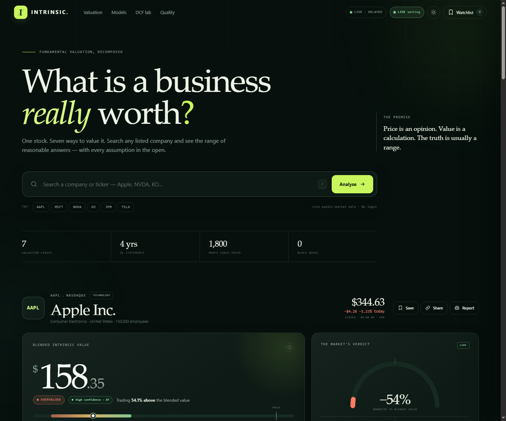

# Intrinsic

A stock valuation workbench. Search any listed company and see its value through seven independent lenses — with every assumption visible and adjustable. Runs locally, on your LAN, or on a free public host.



## Quick start

**Windows:** double-click `start.bat`, or run:

```powershell
.\start.ps1
```

**Any OS with Python 3.10+:**

```bash
python server.py --open
```

Then open <http://127.0.0.1:8765>. No API key, account, package install or build step is required.

The server uses only Python's standard library. It binds to `127.0.0.1` by default. To use another port:

```bash
python server.py --port 9000
```

### Run it from another device or the cloud

The server reads `PORT` and `HOST` from the environment, so hosting platforms can inject their own port and a public bind:

```bash
PORT=8000 HOST=0.0.0.0 python server.py
```

A Dockerfile is included, and `/healthz` is a plain-text probe for platform health checks:

```bash
docker build -t intrinsic .
docker run -p 8000:8000 intrinsic
```

See **[DEPLOY.md](DEPLOY.md)** for free hosting options (Render, Fly.io, Koyeb, Railway) plus a no-account Cloudflare Tunnel route.

## Security

Intrinsic holds **no API keys, tokens or personal data** — it reads public market data and stores nothing about visitors. Publishing it safely is handled by defaults, not configuration:

- **Strict security headers** — CSP with no inline scripts, framing denied, no referrer leakage, device APIs disabled
- **Rate limiting** — 120 requests/minute per client, so the link cannot be scripted as a free data proxy
- **No version disclosure** — the `Server` header carries no version number
- **Redacted errors** — visitors see a plain message and a reference; full detail stays in the server log
- **Read-only** — the server answers `GET` only, with no upload or state-changing route

Two optional environment variables control access and diagnostics:

| Variable | Purpose |
|---|---|
| `INTRINSIC_PASSWORD` | Put the whole site behind a Basic-auth login |
| `INTRINSIC_USERNAME` | Username for that login (default `intrinsic`) |
| `INTRINSIC_DIAG=1` | Enable `/api/diag`, which reports which upstream calls fail |
| `INTRINSIC_RATE_LIMIT` | Requests per minute per client (default 120) |

See **[SECURITY.md](SECURITY.md)** for the full list, a pre-publish checklist, and how to verify for yourself that no credentials are present.

## What it does

- **Search any listed stock** by company name or ticker, with global exchange coverage through Yahoo Finance.
- **Seven valuation lenses**
  - Discounted cash flow (5/10/15-year fade, editable growth, FCF margin, WACC, terminal growth, SBC treatment)
  - Reverse DCF — the FCF growth rate the market price already implies
  - Earnings power value — no-growth earning power; a bank-specific equity version
  - Peer P/E — median of up to six live sector peers, with a static fallback
  - EV/EBITDA — live peer median for operating companies
  - Price/book — the equivalent peer multiple for banks and insurers
  - Revised Graham formula
  - Graham number
  - Dividend discount model (shown only when dividends exist; weighted only when the payout is material)
- **Blended intrinsic value** with dynamic weights that change for banks, negative-FCF companies and low-payout companies.
- **Live peer group** — sector peers, subject company and median P/E, EV/EBITDA and P/B in one table.
- **Confidence score** — model coverage, data completeness, dispersion, DCF terminal risk, peer support and red flags.
- **Football field** showing every model's bear–bull range against the market price.
- **Monte Carlo range** — 1,800 randomized DCF paths with P10/P50/P90 and the probability of beating today's price.
- **Sensitivity matrix** for WACC and terminal growth.
- **Business quality score** built from ROE, margins, growth, leverage, cash conversion and earnings consistency, plus red flags.
- **Watchlist** saved in `localStorage` (no account or server database).
- **Live price refresh** — the LIVE toggle in the header polls a lightweight quote endpoint every 60 seconds while the tab is visible, and recomputes the upside, verdict, reverse DCF, multiples and Street panel in place without reloading. The preference persists; polling pauses when the tab is hidden.
- **New-filing detection** — the app remembers which statements it used (latest quarter, fiscal-year end, annual history) and checks for a newer filing on load, when the tab regains focus and every 5 minutes while LIVE is on. A banner offers **Update valuation**, which refetches with `?refresh=1` and recalculates on the new data while keeping your DCF assumptions.
- **Four-quarter TTM** — trailing figures are rolled up from the last four consecutive quarterly filings, so the latest report is reflected even before a vendor's ready-made TTM figure catches up. The footer shows exactly which periods each analysis uses.
- **Shareable URLs** (`?ticker=AAPL`) and a print/PDF-friendly report view. A sample report is in `screens/intrinsic-report.pdf`.
- **Ink and paper themes**, responsive mobile layout, keyboard-accessible search.
- **Offline/demo fallback** for ten large companies if live data is unavailable. Fallback data is clearly labelled — it is a snapshot, not a live quote.

## Data and methodology

Live data comes from public Yahoo Finance endpoints:

- Search, quote/chart and one-year price history.
- A cheap quote-only endpoint (`/api/quote/<symbol>`) for live refresh, cached for 45 seconds.
- Annual, trailing and quarterly fundamentals time series. The last four consecutive quarters are summed into a TTM row, which takes precedence over the vendor's trailing figure.
- A data-version endpoint (`/api/data-version/<symbol>`) that compares the filing periods the page is showing with the live ones.
- Analyst targets and company profile, when available.
- A live sector peer set using Yahoo's public peer recommendation endpoint plus a sector-constrained universe. Peer sets are cached for one hour.
- Balance-sheet currencies are converted into the quote currency when Yahoo supplies an FX rate.

The server caches each full valuation for 15 minutes (bypassable with `?refresh=1`) and keeps a disk cache for up to 30 days. If the live valuation fails but a saved snapshot exists, the saved snapshot is served and labelled. If only statements fail, the live price is combined with the saved fundamentals and labelled "Partial data". If everything fails, bundled snapshots in `data/fallback/` are served with a visible "Demo snapshot" notice.

The LIVE toggle updates **price-driven** outputs in real time, while model values (DCF, EPV, Graham, peer multiples) change when the valuation refreshes — either after the 15-minute cache or when you apply a detected filing.

Model weights are deliberately not fixed across all companies:

| Business type | Adjustments |
|---|---|
| Standard operating company | DCF 30%, P/E 20%, EPV 16%, EV/EBITDA 12%, Graham formula 8%, Graham number 4%, DDM 10% (only if payout is material) |
| Bank / insurer | DCF and EV/EBITDA excluded; P/E 38%, EPV 22%, DDM 16%, Graham formula 14%, Graham number 10%, P/B 12% |
| Negative free cash flow | DCF and reverse DCF excluded; remaining weights renormalize |
| Low dividend payout | DDM displayed for completeness but excluded from the blend |

All weights renormalize over the models that are actually eligible. The headline value is a weighted average; the bear/bull range is the weighted average of each model's own range. The confidence score is separate from the upside/downside signal — a stock can be clearly overvalued with high confidence in the estimate.

### Important limitations

This is an educational tool, not investment advice. It does not know management quality, competitive threats, litigation, accounting quality, related-party transactions or macro shocks. A DCF is highly sensitive to terminal assumptions. Peer sets are sector-level rather than hand-curated comparable-company analysis, and fall back to static benchmarks if the live peer request fails. Quotes are delayed by at least 15 minutes. Always read the filings and do your own work.

## Tests

The valuation engine is plain ES modules, tested with Node's built-in test runner:

```bash
node --test tests/valuation.test.mjs
```

If your environment restricts child-process spawning (including some sandboxed shells), run the same tests in-process:

```bash
node --test --test-isolation=none tests/valuation.test.mjs
```

The 11 tests cover DCF monotonicity, reverse-DCF round-tripping, negative-FCF handling, bank EPV, peer-median multiples, bank P/B, weight normalization, confidence output, Graham math, deterministic Monte Carlo and output serialization.

## Project structure

```
intrinsic/
├── server.py                  # dependency-free HTTP + Yahoo data layer
├── start.ps1 / start.bat      # one-click Windows launcher
├── static/
│   ├── index.html
│   ├── css/styles.css
│   └── js/
│       ├── app.js             # UI, interactions, charts
│       └── valuation.js       # pure valuation engine
├── data/fallback/             # ten labelled demo snapshots
├── tests/valuation.test.mjs
└── screens/                   # verification screenshots
```

## Best next improvements

1. **Editable peer groups.** Live sector medians are implemented, but the next step is letting the user add/remove individual comparables and save a custom peer set per company.
2. **SEC filings, not just vendor data.** Pull XBRL company facts and the latest 10-K/10-Q directly so segment data, leases, pensions, capitalized software and SBC are handled properly.
3. **Alerts that matter.** Watchlist notifications when price crosses a chosen margin-of-safety threshold or when assumptions no longer support the thesis.
4. **Saved scenarios and portfolio mode.** Persist multiple DCF cases per company; weight a portfolio by upside and quality, not just position size.
5. **Better confidence calibration.** Backtest the confidence score against realised forecast errors, so the label means something empirically.
6. **Owner-earnings model.** A maintenance-capex and working-capital model would sit between DCF and EPV and is particularly useful for capital-intensive businesses.
7. **Historical backtest.** Re-run today's models on prior-year fundamentals to show whether the framework would have helped, without look-ahead bias.
8. **AI narrative with citations.** An optional plain-English summary that cites the exact metric and filing passage behind each claim — never a free-floating price target.
9. **PWA/offline mode.** Cache the app shell and the last few companies so the watchlist remains usable on a plane.
10. **Data provenance panel.** Show each input's source, period, currency and last-updated timestamp; make stale or estimated fields explicit.
